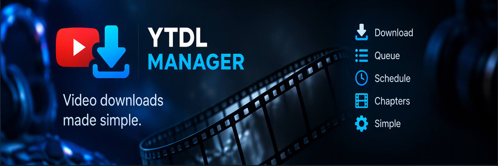
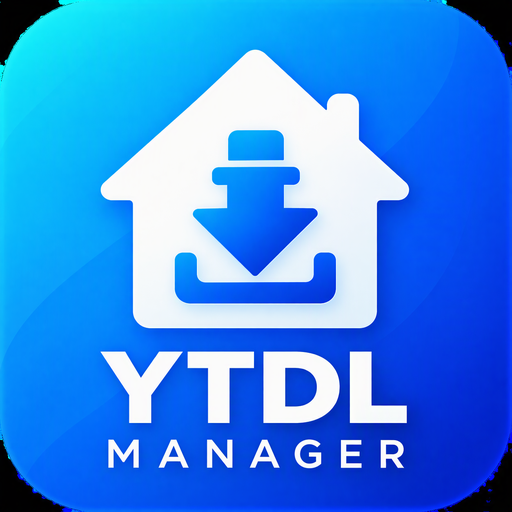
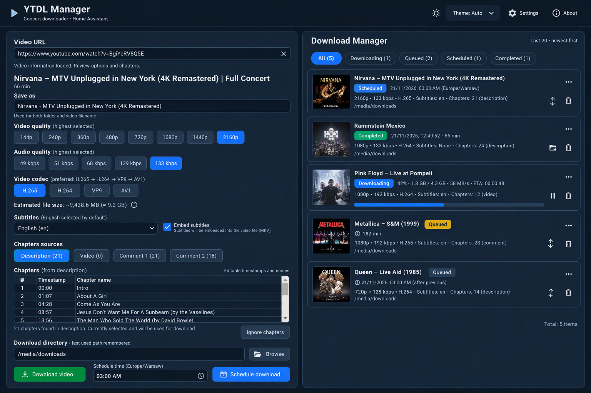

# YTDL Manager

A self-hosted yt-dlp download manager for **Home Assistant OS**, designed for concert and long-form video collections.

> **Community project. Not affiliated with or endorsed by Home Assistant or YouTube.**
>
> **Status:** experimental, AMD64-only. Test with short videos before relying on scheduling, retries, chapter embedding or large downloads.

## Features

- Native Home Assistant Ingress UI, no external HTTP port required.
- Dynamic video resolution, audio bitrate and available codec selection (H.265, H.264, VP9, AV1 where provided).
- Estimated download size when metadata permits.
- English subtitle preference and optional embedded subtitles.
- Chapters from video metadata or description; optional comment setlist search, editable timestamps and names, embedded into MKV.
- Custom folder/file name and media directory browser.
- Download Manager showing 20 recent tasks, queue, cancellation and resume.
- Scheduled downloads in Home Assistant timezone and sequential processing.
- Automatic retry attempts after five minutes, up to three times.
- Light/dark UI controls.

## Technology (development baseline)

| Component | Version |
|---|---|
| Home Assistant OS | 18.4 (development environment) |
| Home Assistant Core | 2026.11.2 (development environment) |
| Home Assistant Supervisor | 2026.11.0 (last reported) |
| yt-dlp | 2026.10.26 (pinned) |
| yt-dlp-ejs | 0.8.0 (pinned) |
| Deno | Alpine package, observed 2.7.4 |
| FFmpeg | Alpine package, observed 8.1.3 |
| Python | Alpine package, Python 3.14 observed |
| Base image | Alpine Linux 3.24 |
| Architecture | amd64 |

Deno, FFmpeg and Python versions may change when the image is rebuilt because Alpine packages are not pinned to an exact patch version.

## Installation

1. In Home Assistant go to **Settings > Apps > Install app > Repositories**.
2. Add the URL of this repository.
3. Find **YTDL Manager** in the added repository, select **Install**.
4. Under **Configuration**, set `download_directory` to an existing, writable directory under `/media`.
5. Start the app, then select **Open Web UI**.

This release is built locally by Supervisor. Initial installation can take several minutes and requires Internet access to download dependencies.

## Usage

Paste a supported YouTube URL and wait for analysis. Select quality, codec and subtitles. The highlighted chapter source is used automatically; choose **Ignore chapters** to omit chapters. Click **Download video** or select a time and **Schedule download**. Scheduled jobs run one at a time.

## Storage and privacy

- The default directory is `/media/downloads`; configure it for your environment.
- The app stores job history and preferences in the app's persistent `/data` volume.
- It does not intentionally save separate JPEG thumbnails or chapter sidecar files beside videos.
- Do not publish credentials, cookie files, private network addresses or your personal library contents.

## Limitations

- YouTube may restrict formats, subtitles, comments or downloads.
- File-size estimates are not guaranteed.
- Download continuation depends on the source still supporting resumption.
- Comment search is bounded and may not cover every comment.
- Chapter/subtitle embedding must be verified for individual videos.
- Current build supports AMD64 only; no prebuilt GHCR image yet.

## Credits

Maintained by **[@shafran666](https://github.com/shafran666)**. Built on [yt-dlp](https://github.com/yt-dlp/yt-dlp), Deno, FFmpeg and Home Assistant's community app framework. See their respective licenses.

## License

The original YTDL Manager project code is released under the MIT License. Third-party components retain their own licenses.

## ☕ Support the Project

YTDL Manager is free and open-source software.

If you enjoy using it and would like to support future development, you can buy me a coffee. Every contribution is appreciated!

## Version 1.0.1

This update adds Home Assistant timezone scheduling, broader single-video yt-dlp support, improved chapter comments and bracket handling, and a subtitle-error fallback. See [Changelog](ytdl_manager/CHANGELOG.md).

## Roadmap

See [GitHub Issues](https://github.com/shafran666/ha-ytdl-manager/issues) and [Milestones](https://github.com/shafran666/ha-ytdl-manager/milestones) for planned improvements, testing and future releases.

- **v1.0.2:** Reliability and regression testing
- **v1.1.0:** Video search
- **v1.2.0:** Media management

## Version 1.0.2

Reliability update: disk-space monitoring, smoother progress and ETA, and clearer errors. See [Changelog](ytdl_manager/CHANGELOG.md) and [GitHub Issues](https://github.com/shafran666/ha-ytdl-manager/issues).
